

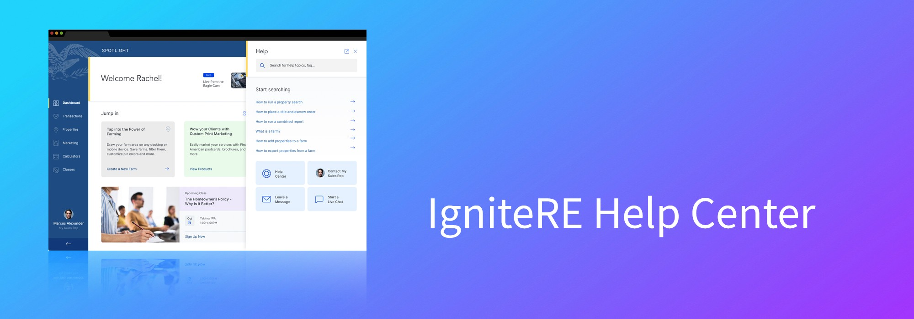

# IgniteRE Help Center & Chat Support
### A UX case study: bringing support *inside* a real estate management platform

**Ravi Myneni** · AI-Native UX Designer · Hyderabad, India

### 🌐 [View the case study website →](https://suvarnamyneni-project.github.io/ignitere-help-center-case-study/)

---

## 📌 At a glance

| | |
|---|---|
| **Product** | IgniteRE, a real estate management platform for agents and property managers |
| **What I designed** | An in-app **Help Center** (searchable knowledge base) + **Chat Support** (chatbot with live-agent handoff) |
| **Tool** | Figma |
| **Process** | Empathize → Define → Ideate → Design → Test & Iterate → Measure |
| **Headline results** | ⚡ **50%** faster response times · 🙋 **30%** of users self-resolve · ⭐ **25%** higher satisfaction |

---

## 🧭 Table of contents

- [Overview](#-overview)
- [The UX process at a glance](#-the-ux-process-at-a-glance)
- [1. Empathize & Discover](#1--empathize--discover)
- [2. Define](#2--define)
- [3. Ideate](#3--ideate)
- [4. Design](#4--design)
  - [Wireframes](#wireframes)
  - [High-fidelity mockups](#high-fidelity-mockups)
- [5. Test & Iterate](#5--test--iterate)
- [6. Results & Impact](#6--results--impact)
- [Learnings & Conclusion](#-learnings--conclusion)
- [Contact](#-contact)

---

## 🔎 Overview

**IgniteRE** is a dynamic real estate management platform used by **real estate agents and property managers** to streamline their daily tasks. As the platform grew in complexity and features, users began to experience friction when they needed support. They often struggled to find timely assistance, which led to frustration and lower satisfaction.

To address these pain points, we designed and integrated a **Help Center and Chat Support directly inside the IgniteRE application**, improving the overall user experience.

  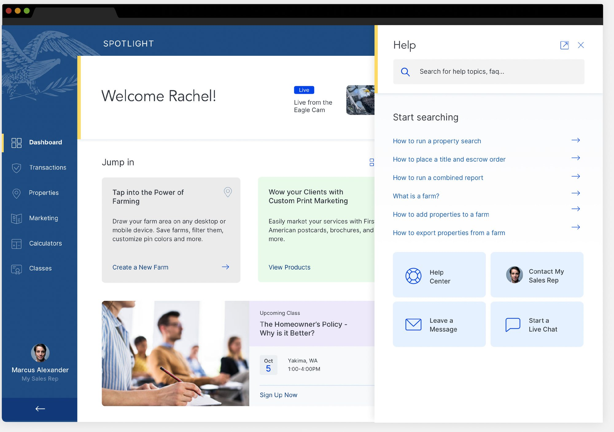
   <i>The final Help panel opens beside the user's current page, so they never lose their place.</i>

| | |
|---|---|
| **Role** | UX/UI Design: Help Center & Chat Support experience |
| **Tool** | Figma |
| **Platform** | IgniteRE web application (in-app help panel) |
| **Users** | Real estate agents and property managers |

> **Problem statement:** IgniteRE users had no fast, in-context way to get help. Support lived outside the app, tickets were slow, and the same questions kept coming back, so users got frustrated and the support team got overloaded.

---

## 🔁 The UX process at a glance

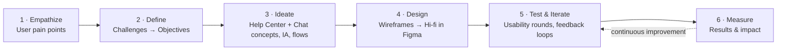

---

## 1 · 🤝 Empathize & Discover

The first step was understanding what support felt like for IgniteRE's users as the platform grew.

### Target users

| User group | What they rely on IgniteRE for | What they need from support |
|---|---|---|
| **Real estate agents** | Streamlining daily tasks across the platform's growing feature set | Quick, in-context answers without leaving their work |
| **Property managers** | Managing properties and day-to-day workflows | Timely help for urgent problems, and self-serve guidance for common how-tos |

### What users were experiencing

| 😣 Pain point | What it meant for users |
|---|---|
| **Support lived outside the app** | The existing support system was external and often time-consuming to reach |
| **Slow ticket resolution** | The traditional ticketing system meant long waits, hurting users who needed urgent help |
| **Repeating the same questions** | Many users had similar questions about specific features, which created repetitive requests and more work for the support team |
| **Growing complexity** | As features were added, users ran into more friction and struggled to find timely help |

### The "before" support journey

This journey is based only on the pain points above:

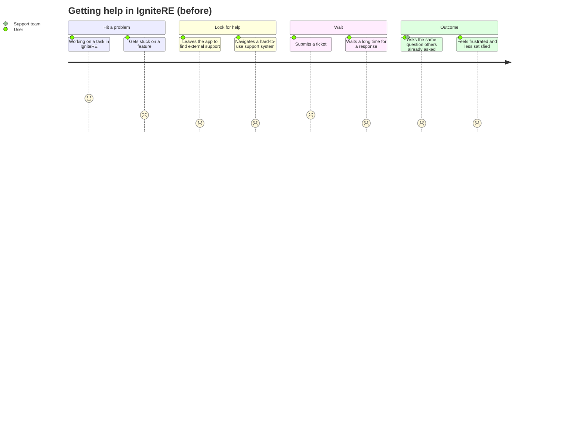

---

## 2 · 🎯 Define

### Challenges → Objectives → Solutions

| # | Challenge | Objective | Design solution |
|:-:|---|---|---|
| 1 | **Difficulty finding support resources.** The support system was external and time-consuming to access | **Improve accessibility to support.** Make help resources easy to reach within the app | In-app Help panel plus a **persistent chat widget** in the same place on every page |
| 2 | **Slow resolution times.** Ticketing caused long waits for urgent issues | **Reduce resolution time.** Give users faster, more efficient support | **Chatbot** first response with a **live-agent handoff** that keeps the user's context |
| 3 | **High volume of repetitive inquiries.** Similar feature questions overloaded the support team | **Enhance self-service.** Let users solve common problems on their own with minimal effort | **Searchable knowledge base** with categories and **step-by-step guides** with visuals |
| - | Support features could disrupt the existing UI | **Deliver a seamless experience.** Integrate support without disrupting the app's interface and flow | Panel that matches the app's look, feel and branding: **unobtrusive but always available** |

### How Might We…

> 💡 **HMW** give agents and property managers help *at the moment they need it*, without making them leave the page they're working on?
>
> 💡 **HMW** let users answer common questions themselves, so the support team can focus on the issues that really need a person?
>
> 💡 **HMW** make escalating to a human fast and smooth, without users having to repeat themselves?

---

## 3 · 💡 Ideate

Two complementary concepts came out of the objectives:

<table>
<tr>
<td width="50%" valign="top">

### 📚 Concept A: In-app Help Center
*Make help content easy to find, organized and actionable.*

- **Searchable knowledge base:** keyword search with predictive results
- **Categorized content:** intuitive categories that mirror the product
- **Step-by-step guides & visuals:** instructions paired with screenshots, GIFs and videos

</td>
<td width="50%" valign="top">

### 💬 Concept B: Chat Support
*Focus on ease of use, accessibility and efficiency.*

- **Persistent chat widget:** always in the same place, with no page change needed
- **Chatbot assistance:** answers FAQs or points users to relevant Help Center articles
- **Live-agent handoff:** escalate when the bot can't resolve the issue, with context passed along
- **Real-time feedback:** users rate the support experience

</td>
</tr>
</table>

### Information architecture

Help content was organized into categories that match the areas of the product users already know:

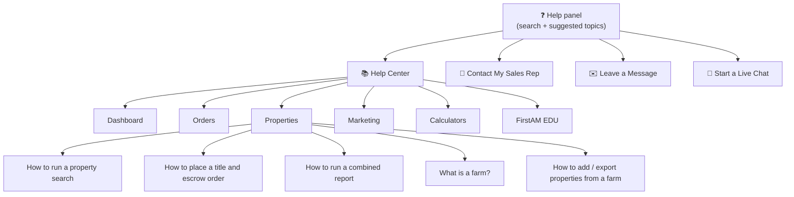

Categories and sample articles are taken from the project wireframes. The core categories in the brief were Dashboard, Orders, Properties and Marketing.

### User flow: from self-service to live agent

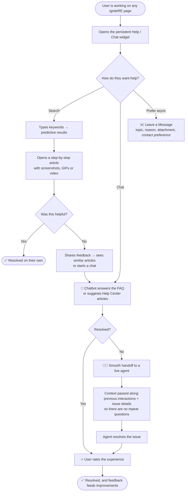

---

## 4 · 🎨 Design

### Design principles

| Principle | How it shows up in the design |
|---|---|
| **Help without leaving the page** | A side panel opens next to the user's current screen. It can be **docked** or **undocked** into its own window |
| **One consistent entry point** | The chat/help icon sits in the **same location across the app** |
| **Self-service first, human always available** | Search and suggested topics come first, and four clear routes are always visible: *Help Center · Contact My Sales Rep · Leave a Message · Start a Live Chat* |
| **Show, don't just tell** | Articles combine step-by-step text with screenshots, GIFs and video |
| **Feels native to IgniteRE** | Look and feel match the app's existing design and branding |

### Wireframes

Low-fidelity wireframes in Figma mapped every state of the help experience before any visual design.

#### 🔍 Search: initial state → typing → results
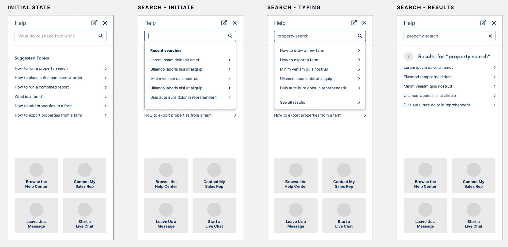

*Suggested topics greet the user, recent searches appear on focus, predictive results update while typing, and a full results list is one tap away.*

#### 📄 Help article & "Was this helpful?" feedback
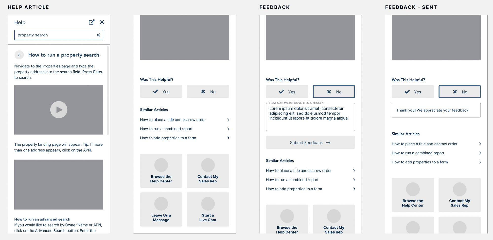

*Step-by-step articles with media, inline feedback (and a "How can we improve this article?" field), plus similar articles to keep users moving.*

<b>▶ More wireframes: video modal, Help Center categories, Sales Rep, Leave a Message, Live Chat, docked/undocked panel</b>

 

#### 🎬 Video guide modal
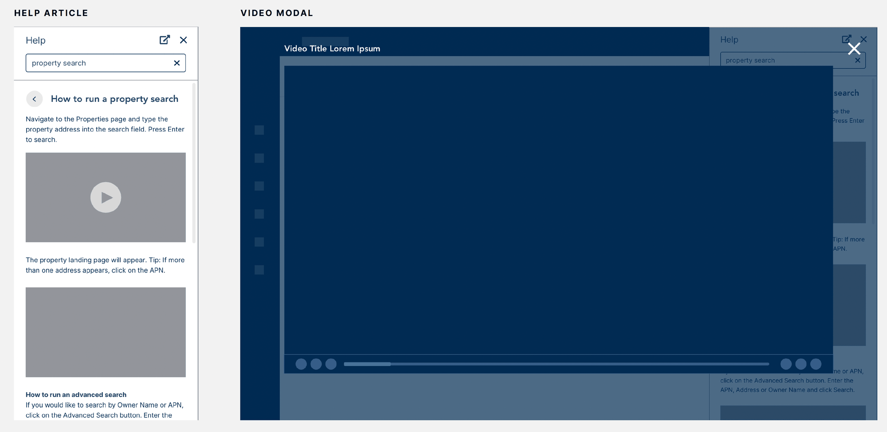

#### 📚 Help Center categories & My Sales Rep
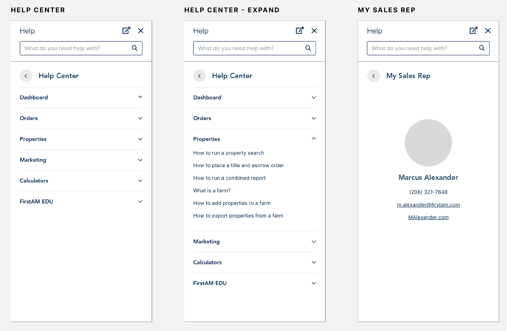

#### ✉️ Leave a Message: empty → filled → sent
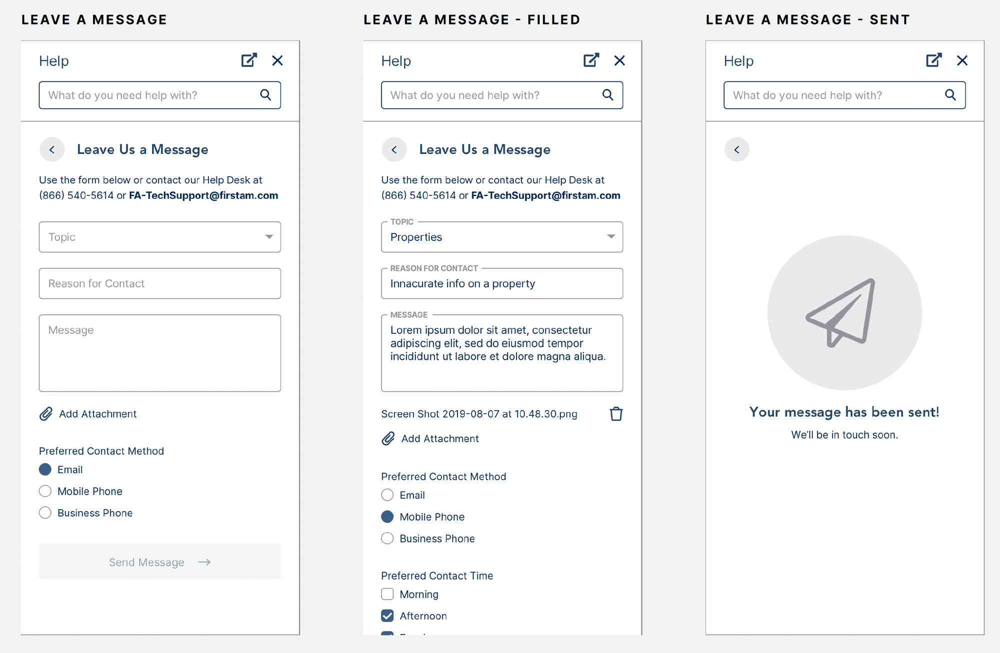

#### 💬 Live Chat: start → typing → sent → return
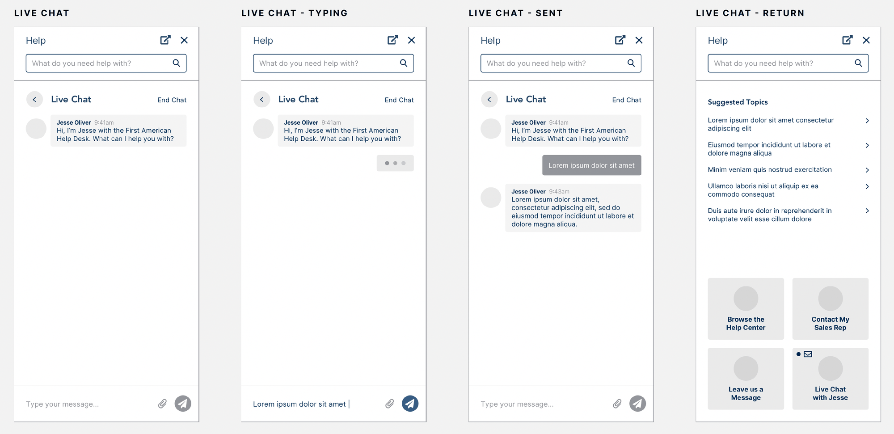

#### 🪟 Docked vs. undocked panel
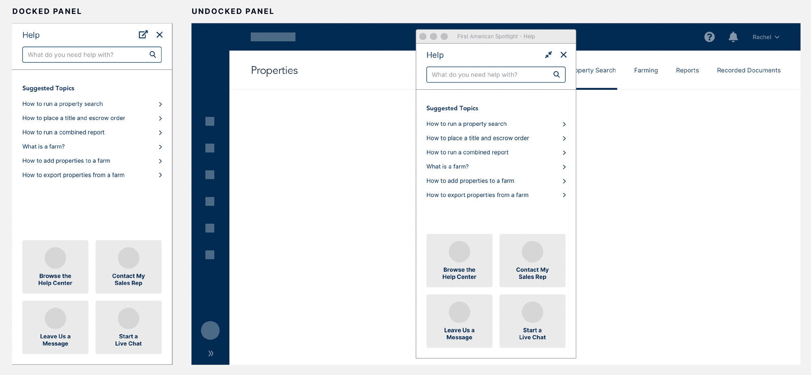

### High-fidelity mockups

The wireframes then became polished, on-brand screens. Key details: a soft accent edge marking the panel, clear iconography for the four support routes, and generous spacing for readability.

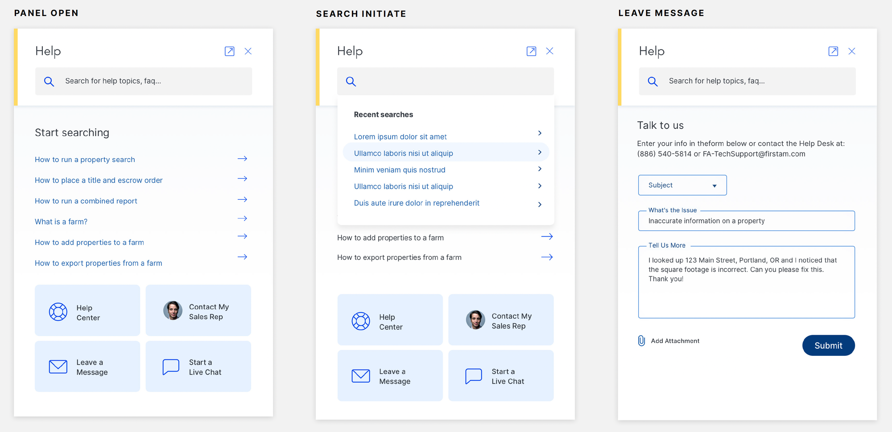

*Panel open · search initiated · "Talk to us" message form*

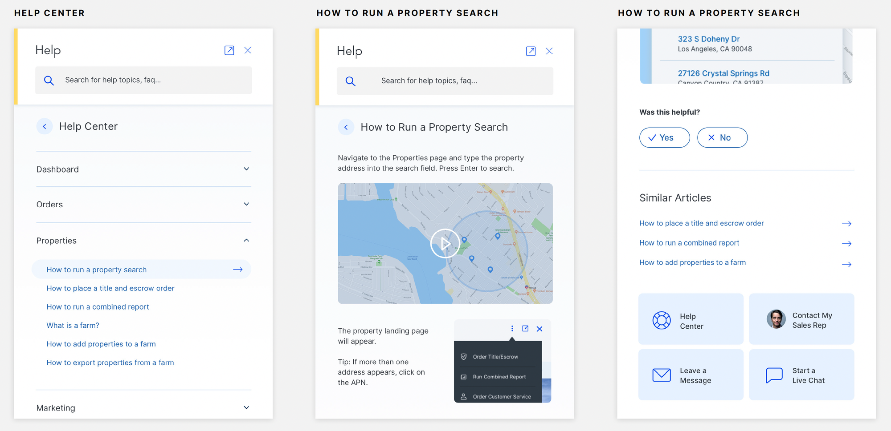

*Help Center categories · "How to Run a Property Search" step-by-step article · feedback & similar articles*

### Key features delivered

| Feature | What it does | Objective it serves |
|---|---|---|
| 🔍 **Searchable knowledge base** | Keyword search with predictive results and query-based articles | Self-service, accessibility |
| 🗂️ **Categorized content** | Dashboard, Orders, Properties, Marketing (plus more) for easy browsing | Self-service |
| 🪜 **Step-by-step guides** | Detailed instructions with screenshots, GIFs and videos | Self-service |
| 💬 **Persistent chat widget** | Same location everywhere; start a conversation without leaving the page | Accessibility, seamless experience |
| 🤖 **Chatbot assistance** | Answers FAQs or links to relevant Help Center articles | Faster resolution, fewer repetitive inquiries |
| 🧑‍💼 **Live-agent handoff** | Seamless escalation with prior interactions and issue details passed along | Faster resolution |
| ⭐ **Real-time feedback** | Users rate the support experience and articles | Continuous improvement |
| 🧩 **Seamless integration** | Matches IgniteRE's look, feel and branding; unobtrusive but always available | Seamless experience |

### Design system & consistency

- Reused IgniteRE's existing **visual language and branding**, so support feels like part of the product rather than a bolt-on.
- A **repeatable panel pattern**: header (title, undock, close) → search → content → persistent support shortcuts. Every state (search, article, category, message, chat) uses the same structure.
- **Consistent components across states:** list rows with chevrons, accordion categories, form fields with floating labels, Yes/No feedback buttons and quick-action tiles.

---

## 5 · 🧪 Test & Iterate

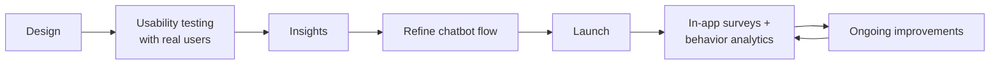

| Stage | What we did | What we learned / changed |
|---|---|---|
| **Usability testing (pre-launch)** | Ran **several rounds of usability testing with real users**, observing how they used both the Help Center and Chat Support | ✅ Users liked how **simple and efficient** the Help Center search was. 🔧 We **adjusted the chatbot's flow** to handle more nuanced queries |
| **Feedback loops (post-launch)** | Kept collecting feedback through **in-app surveys** and **user behavior analytics** | 🔁 Made ongoing improvements to refine the experience and make sure users got the most value from the new features |

---

## 6 · 📈 Results & Impact

| ⚡ Faster resolution | 🙋 Self-service adoption | 💪 Reduced frustration | 📊 Engagement | ⭐ Satisfaction |
|:-:|:-:|:-:|:-:|:-:|
| **50%** | **30%** | **40%** | **+20%** | **+25%** |
| reduction in response times | of users resolved issues independently | say they now feel more empowered to solve problems | increase in user engagement | increase in user satisfaction scores |

- **Faster issue resolution:** Chat Support led to a **50% reduction in response times**, with many users now getting immediate answers from the chatbot or a live agent.
- **More self-service:** **30% of users resolved their issues independently**, which reduced the load on live support agents and raised overall satisfaction.
- **Less frustration:** users reported feeling more confident in the app, with **40%** saying they now feel **more empowered to solve problems on their own**.
- **Better engagement:** always-available support led to a **20% increase in user engagement**, with users spending more time in the app knowing help was a click away.
- **Positive feedback:** **user satisfaction scores rose 25%**, especially for the clarity and usefulness of Help Center articles and the responsiveness of live chat.

---

## 🧠 Learnings & Conclusion

**Conclusion.** Integrating the Help Center and Chat Support significantly improved the experience for IgniteRE users. Quick access to helpful resources and real-time support reduced frustration, improved task completion times and increased user satisfaction.

**Key takeaways**

1. **In-context support matters.** Putting help *inside* the workflow, with a consistent entry point and no page change, removed the biggest barrier: getting to help at all.
2. **Self-service and human support work together.** Good search, clear categories and visual guides take care of repetitive questions, so live agents can focus on what really needs a person.
3. **Handoffs should carry context.** Passing prior interactions and issue details to the live agent means users never have to repeat themselves.
4. **Launch is the start of iteration.** Usability testing shaped the chatbot flow, and in-app surveys plus analytics keep improving the experience after release.
5. **Good support UX helps the business too.** The project improved the customer experience and also made support operations more efficient for the IgniteRE team.

---

## 📬 Contact

**Ravi Myneni**, AI-Native UX Designer · 8+ years · Hyderabad, India

All visuals in this case study come from the original IgniteRE Help Center project file. All metrics are as reported in the project documentation.
